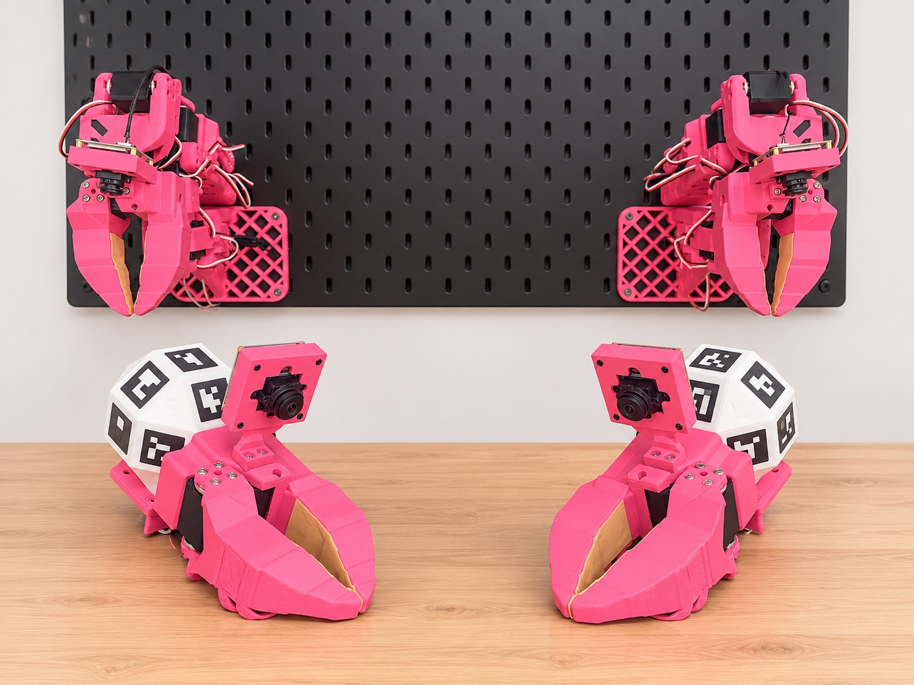
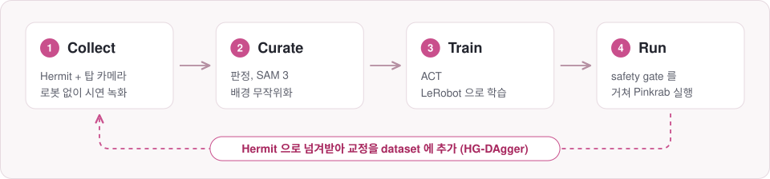
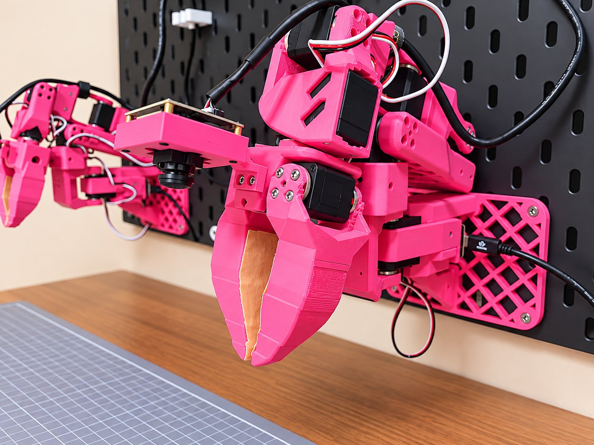
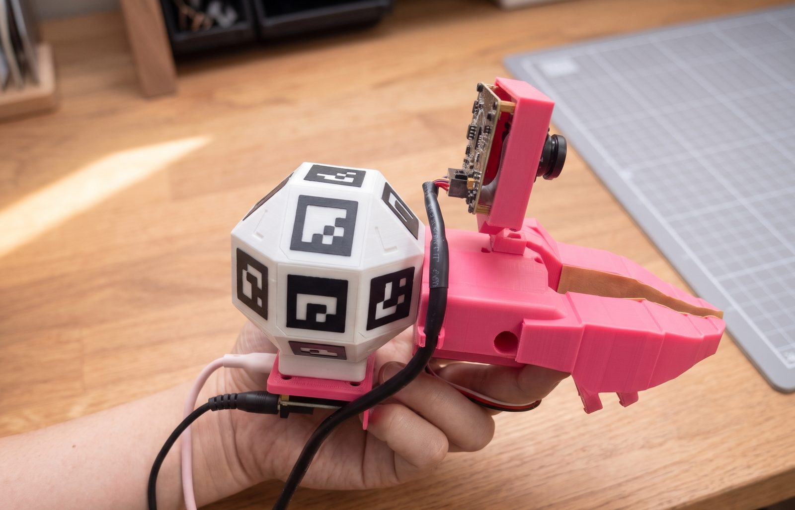

  

<h1 align="center">Pinkrab</h1>

  <b>벽에 거는 6-DoF 양팔 로봇과, 그 로봇을 가르치는 손잡이 그리퍼 Hermit.</b> 
  손으로 시연을 수집하고, LeRobot 으로 학습하고, 팔에서 policy 를 실행합니다.

  <a href="README.md">English</a> · <b>한국어</b>

  
  
  
  
  

  <a href="https://woolimi.github.io/pinkrab/"><b>문서</b></a> ·
  <a href="https://woolimi.github.io/pinkrab/hardware/bom/">부품 목록</a> ·
  <a href="https://woolimi.github.io/pinkrab/hardware/print/">출력 파일</a> ·
  <a href="https://makerworld.com/ko/models/3527244-pinkrab-hermit-6-dof-1-gripper">MakerWorld</a> ·
  <a href="https://woolimi.github.io/pinkrab/start/install/">설치</a>

---

Pinkrab (Pink + Crab) 은 책상 뒤 벽의 IKEA SKÅDIS 페그보드에 볼트로 고정하는
6-DoF 팔 두 개입니다. 팔마다 [SO-ARM 101] 에 출력한 wrist yaw 관절을 하나 더하고
L 자 베이스를 새로 달았습니다. 몸체를 벽에 고정한 채 집게만 움직여 일하는 모습이
게와 같습니다.

**Hermit** 은 팔의 claw 에 손잡이를 단 [UMI] 방식의 손잡이 그리퍼입니다. 팔과 같은
claw, jaw, 손목 카메라를 쓰기 때문에 Hermit 으로 녹화한 영상으로 학습한 policy 는
로봇에서 실행될 때도 같은 화면을 봅니다. 시연은 로봇 없이 수집합니다.

부품 출력부터 policy 실행까지 모든 과정은 **[문서](https://woolimi.github.io/pinkrab/)** 에 있습니다.

[SO-ARM 101]: https://github.com/TheRobotStudio/SO-ARM100
[UMI]: https://umi-gripper.github.io

## 특징

- **팔마다 관절 여섯 개.** wrist yaw 를 더해 tool 의 위치와 방향을 모두 정할 수
  있으므로, 모든 동작을 URDF 기반 inverse kinematics 로 풉니다. leader arm 은 없습니다.
- **데이터 수집과 teleoperation 을 Hermit 하나로.** 머리에 쓴 탑 카메라가 각 Hermit 의
  UMI 마커를 테이블 마커에 대해 추적해, 매 프레임 책상 좌표계의 tool pose 를 얻습니다.
  같은 추적으로 팔을 실시간으로 움직입니다.
- **Pinkrab Studio.** rig 의 MuJoCo 모델 위에 올린 브라우저 작업대 하나에
  teleoperation, Collect, Curate, Train, Policy 페이지가 있고, 페달 세 개로 조작합니다.
- **ROS 2 safety gate.** 서보로 가는 모든 명령은 gate 하나를 지나며, gate 는 관절 범위,
  책상·보드·다른 팔과의 접촉, 속도·가속도·jerk 한계를 검사합니다.
- **LeRobot 그대로.** 양팔은 robot type `bi_pinkrab_follower` 로 등록되고, policy 는
  LeRobot 의 ACT 로 학습하고 실행합니다.
- **실행 중 교정.** 실행 중인 policy 를 Hermit 으로 넘겨받아 동작을 고치고, 그
  교정을 dataset 에 더합니다(HG-DAgger).

## 작업 흐름

  

| 단계 | 문서 |
|---|---|
| 구매, 출력, 조립 | [부품 목록](https://woolimi.github.io/pinkrab/hardware/bom/) · [부품 출력](https://woolimi.github.io/pinkrab/hardware/print/) · [Pinkrab 조립](https://woolimi.github.io/pinkrab/hardware/assemble-arm/) · [Hermit 조립](https://woolimi.github.io/pinkrab/hardware/assemble-hermit/) |
| 소프트웨어 설치 | [설치](https://woolimi.github.io/pinkrab/start/install/) |
| 설정과 calibration | [준비](https://woolimi.github.io/pinkrab/use/setup/) · [첫 구동](https://woolimi.github.io/pinkrab/use/first-run/) |
| 시연 수집 | [시연 수집](https://woolimi.github.io/pinkrab/use/collect/) |
| dataset 만들기 | [dataset 정리](https://woolimi.github.io/pinkrab/use/curate/) |
| policy 학습 | [학습](https://woolimi.github.io/pinkrab/use/train/) · [policy](https://woolimi.github.io/pinkrab/deep/policies/) |
| 실행과 교정 | [실행](https://woolimi.github.io/pinkrab/use/run/) · [교정 데이터](https://woolimi.github.io/pinkrab/deep/corrections/) |
| 하드웨어 없이 해 보기 | [시뮬레이션](https://woolimi.github.io/pinkrab/use/simulation/) |
| 코드 둘러보기 | [리포 구성](https://woolimi.github.io/pinkrab/deep/repository/) |

## 하드웨어

<table>
  <tr>
    <td width="50%"></td>
    <td width="50%"></td>
  </tr>
  <tr>
    <td align="center">Pinkrab 팔</td>
    <td align="center">Hermit</td>
  </tr>
</table>

| | |
|---|---|
| 관절 | 팔마다 6개 + gripper |
| 서보 | Feetech STS3215 (12 V), 팔마다 7개 |
| 도달 거리 | 보드에서 tool 끝까지 약 570 mm |
| 가반 하중 | 팔을 끝까지 편 상태에서 약 0.45 kg (계산값) |
| 자세 정확도 | 관절 오차 ≤ 0.8°, tool 끝 평균 1 mm (실측) |
| 카메라 | 손목과 Hermit 마다 ELP AR0234 global shutter 어안 카메라, AR0234 탑 카메라 1대 |
| 전원과 bus | 양팔 공용 12 V 6 A 어댑터 1개, 팔마다 USB 로 연결하는 Seeed XIAO bus servo board 1개 |
| 프린터 | 모든 부품을 출력합니다. Bambu Lab P2S 용 Bambu Studio 프로젝트가 들어 있고 [MakerWorld](https://makerworld.com/ko/models/3527244-pinkrab-hermit-6-dof-1-gripper) 에도 올라가 있습니다 |

나사와 수량까지 담은 전체 목록은 [부품 목록](https://woolimi.github.io/pinkrab/hardware/bom/)에 있습니다.

## 기반 프로젝트

Pinkrab 은 다음 프로젝트의 아이디어, 설계, 코드를 바탕으로 합니다.

- [Qubit](https://github.com/0xaiwhisperer/qubit) (The A.I. Whisperer) — 책상 위 벽에 SO-ARM 101 을 다는 아이디어
- [SO-ARM 100 / 101](https://github.com/TheRobotStudio/SO-ARM100) (TheRobotStudio) — 기본 팔, URDF, 대부분의 부품(Apache-2.0)
- [SO-ARM100 additional wrist joint](https://makerworld.com/en/models/2845098) (ahb) — wrist yaw 브래킷(CC BY-SA)
- [UMI, the Universal Manipulation Interface](https://umi-gripper.github.io) (Chi et al.) — 로봇 그리퍼를 손에 드는 복제본으로 시연 수집
- [LeRobot](https://github.com/huggingface/lerobot) (Hugging Face) — dataset 형식, 학습 코드, policy

## 라이선스

Apache-2.0 이며 예외가 하나 있습니다. `wrist_yaw_bracket_left.stl` 과
`wrist_yaw_bracket_right.stl` 은 ahb 의
[SO-ARM100 additional wrist joint](https://makerworld.com/en/models/2845098) 에서
파생한 것이라 **CC BY-SA** 이고, 이 파일에서 파생한 것도 같은 라이선스를 따릅니다.
배경 무작위화에 쓰는 [SAM 3](https://github.com/facebookresearch/sam3) 는 Meta 의
SAM License 로 따로 설치하며 이 리포지토리에 포함되지 않습니다. [NOTICE](NOTICE) 를
참고하세요.
