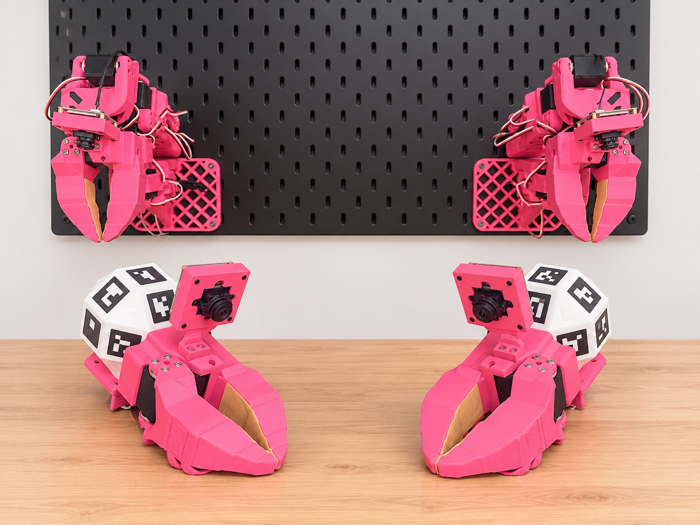
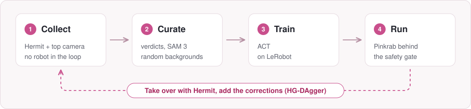
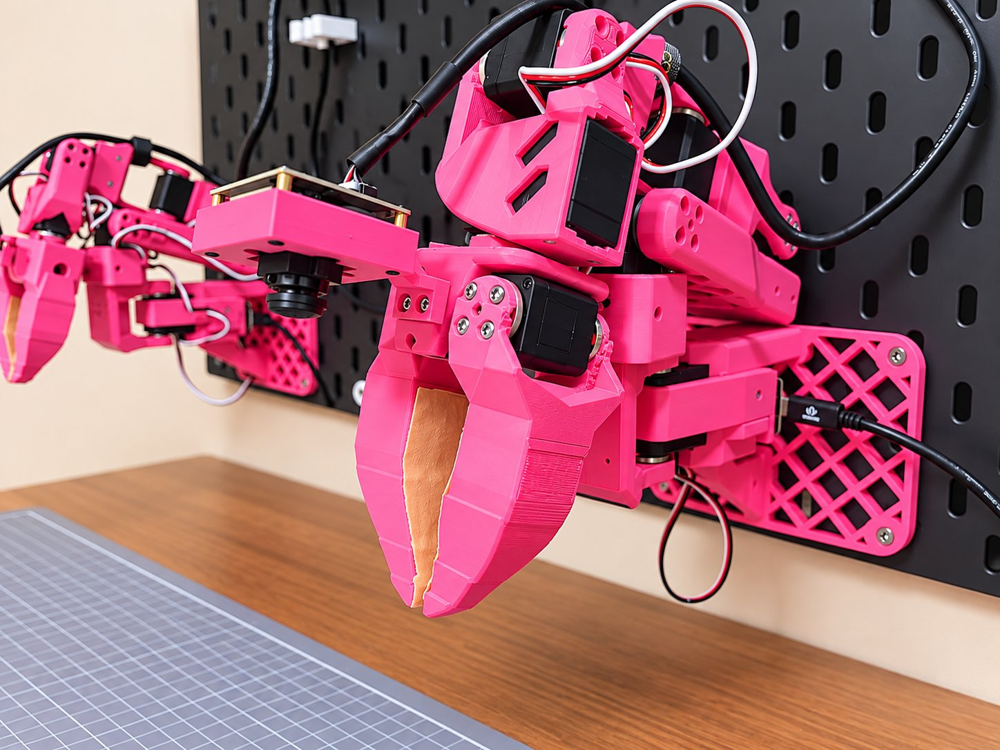
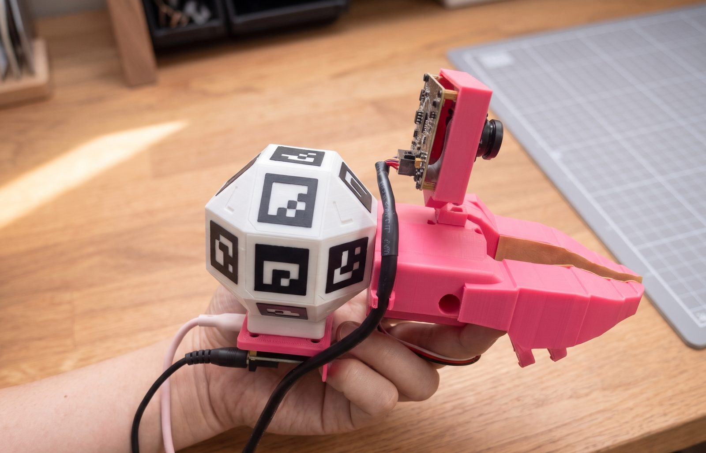

  

<h1 align="center">Pinkrab</h1>

  <b>A wall-mounted, bimanual 6-DoF robot and Hermit, the handheld gripper that teaches it.</b> 
  Collect demonstrations by hand, train with LeRobot, run the policy on the arms.

  <b>English</b> · <a href="README.ko.md">한국어</a>

  
  
  
  
  

  <a href="https://woolimi.github.io/pinkrab/en/"><b>Documentation</b></a> ·
  <a href="https://woolimi.github.io/pinkrab/en/hardware/bom/">Bill of materials</a> ·
  <a href="https://woolimi.github.io/pinkrab/en/hardware/print/">Print files</a> ·
  <a href="https://makerworld.com/en/models/3527244-pinkrab-hermit-6-dof-1-gripper">MakerWorld</a> ·
  <a href="https://woolimi.github.io/pinkrab/en/start/install/">Install</a>

---

Pinkrab (Pink + Crab) is a pair of 6-DoF arms bolted to an IKEA SKÅDIS pegboard
on the wall behind a desk. Each arm is an [SO-ARM 101] with an extra printed
wrist yaw joint and a new L-shaped base. A crab keeps its body still and works
with its claws, and so do these arms.

**Hermit** is the claw of the arm with a handle on it, a [UMI]-style handheld
gripper. It has the same claw, jaw and wrist camera as the arm, so a policy
trained on video recorded with Hermit sees the same picture when it runs on the
robot. Demonstrations are collected without the robot in the loop.

Everything from printing the parts to running a policy is in the
**[documentation](https://woolimi.github.io/pinkrab/en/)**.

[SO-ARM 101]: https://github.com/TheRobotStudio/SO-ARM100
[UMI]: https://umi-gripper.github.io

## Highlights

- **Six joints per arm.** The added wrist yaw gives every arm a full 6-DoF tool
  pose, so all motion is solved with inverse kinematics from the URDF. No leader arm.
- **Hermit for data and teleoperation.** A head-worn top camera tracks the UMI
  marker on each Hermit against a table marker, giving each tool's pose in the
  desk frame every frame. The same tracking drives the arms live.
- **Pinkrab Studio.** One browser workbench over a MuJoCo model of the rig:
  teleoperation, Collect, Curate, Train and Policy pages, driven by a
  three-pedal foot switch.
- **ROS 2 safety gate.** Every command to a servo passes one gate that checks
  joint bands, contact with the desk, board and the other arm, and speed,
  acceleration and jerk limits.
- **LeRobot native.** The pair is registered as the robot type
  `bi_pinkrab_follower`, and policies train and run as LeRobot's ACT.
- **Corrections while running.** Take over a running policy with Hermit, fix
  the motion and add it to the dataset (HG-DAgger).

## Workflow

  

| Step | Docs |
|---|---|
| Buy, print and assemble | [BOM](https://woolimi.github.io/pinkrab/en/hardware/bom/) · [Print](https://woolimi.github.io/pinkrab/en/hardware/print/) · [Arm](https://woolimi.github.io/pinkrab/en/hardware/assemble-arm/) · [Hermit](https://woolimi.github.io/pinkrab/en/hardware/assemble-hermit/) |
| Install the software | [Install](https://woolimi.github.io/pinkrab/en/start/install/) |
| Set up and calibrate | [Setup](https://woolimi.github.io/pinkrab/en/use/setup/) · [First run](https://woolimi.github.io/pinkrab/en/use/first-run/) |
| Collect demonstrations | [Collect](https://woolimi.github.io/pinkrab/en/use/collect/) |
| Build a dataset | [Curate](https://woolimi.github.io/pinkrab/en/use/curate/) |
| Train a policy | [Train](https://woolimi.github.io/pinkrab/en/use/train/) · [Policies](https://woolimi.github.io/pinkrab/en/deep/policies/) |
| Run and correct | [Run](https://woolimi.github.io/pinkrab/en/use/run/) · [Corrections](https://woolimi.github.io/pinkrab/en/deep/corrections/) |
| Try it without hardware | [Simulation](https://woolimi.github.io/pinkrab/en/use/simulation/) |
| Find your way in the code | [Repository layout](https://woolimi.github.io/pinkrab/en/deep/repository/) |

## Hardware

<table>
  <tr>
    <td width="50%"></td>
    <td width="50%"></td>
  </tr>
  <tr>
    <td align="center">Pinkrab arm</td>
    <td align="center">Hermit</td>
  </tr>
</table>

| | |
|---|---|
| Joints | 6 per arm + gripper |
| Servos | Feetech STS3215 (12 V), 7 per arm |
| Reach | about 570 mm from the board to the tool tip |
| Payload | about 0.45 kg, arm fully stretched (calculated) |
| Pose accuracy | joint error ≤ 0.8°, tool tip 1 mm on average (measured) |
| Cameras | ELP AR0234 global-shutter fisheye on each wrist and each Hermit, one AR0234 top camera |
| Power and bus | one 12 V 6 A adapter for both arms, one Seeed XIAO bus servo board per arm over USB |
| Printer | every part is printed; Bambu Studio projects for the Bambu Lab P2S are included and also on [MakerWorld](https://makerworld.com/en/models/3527244-pinkrab-hermit-6-dof-1-gripper) |

The full list, with screws and quantities, is the
[bill of materials](https://woolimi.github.io/pinkrab/en/hardware/bom/).

## Acknowledgements

Pinkrab builds on the ideas, designs and code of these projects:

- [Qubit](https://github.com/0xaiwhisperer/qubit) by The A.I. Whisperer, the idea of an SO-ARM 101 mounted on the wall above a desk
- [SO-ARM 100 / 101](https://github.com/TheRobotStudio/SO-ARM100) by TheRobotStudio, the base arm, URDF and most parts (Apache-2.0)
- [SO-ARM100 additional wrist joint](https://makerworld.com/en/models/2845098) by ahb, the wrist yaw bracket (CC BY-SA)
- [UMI, the Universal Manipulation Interface](https://umi-gripper.github.io) by Chi et al., collecting demonstrations with a handheld copy of the robot's gripper
- [LeRobot](https://github.com/huggingface/lerobot) by Hugging Face, the dataset format, training code and policies

## License

Apache-2.0, with one exception: `wrist_yaw_bracket_left.stl` and
`wrist_yaw_bracket_right.stl` are derived from ahb's
[SO-ARM100 additional wrist joint](https://makerworld.com/en/models/2845098) and
are **CC BY-SA**, so anything derived from them carries the same license.
[SAM 3](https://github.com/facebookresearch/sam3), used for background
randomisation, is installed separately under Meta's SAM License and is not
part of this repository. See [NOTICE](NOTICE).
