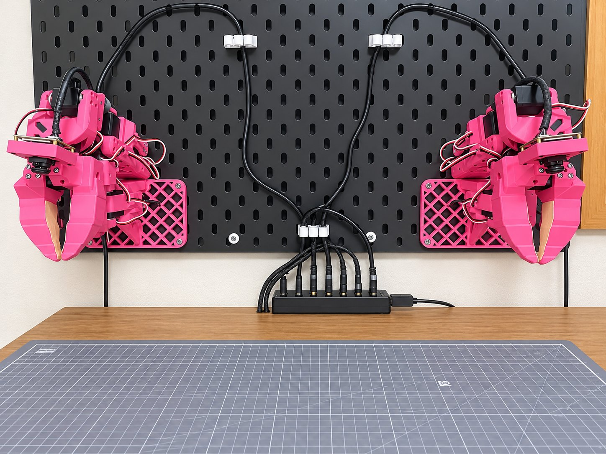
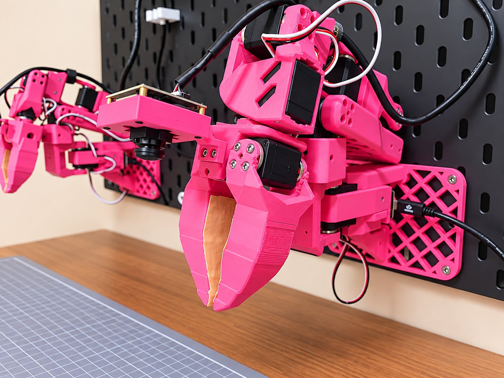
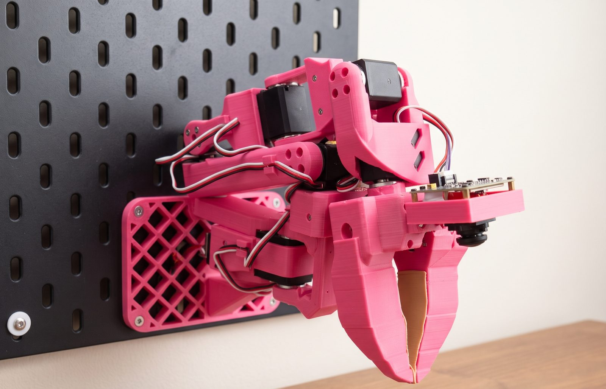
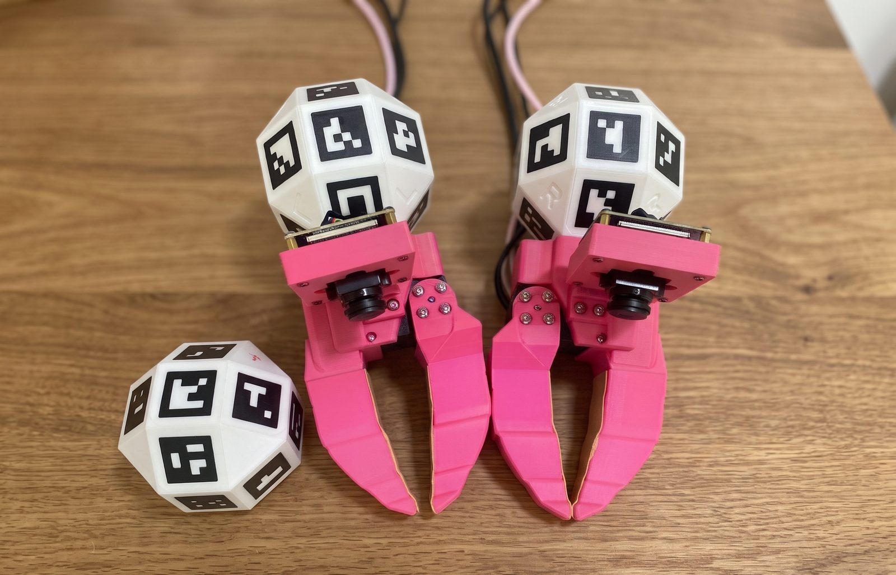
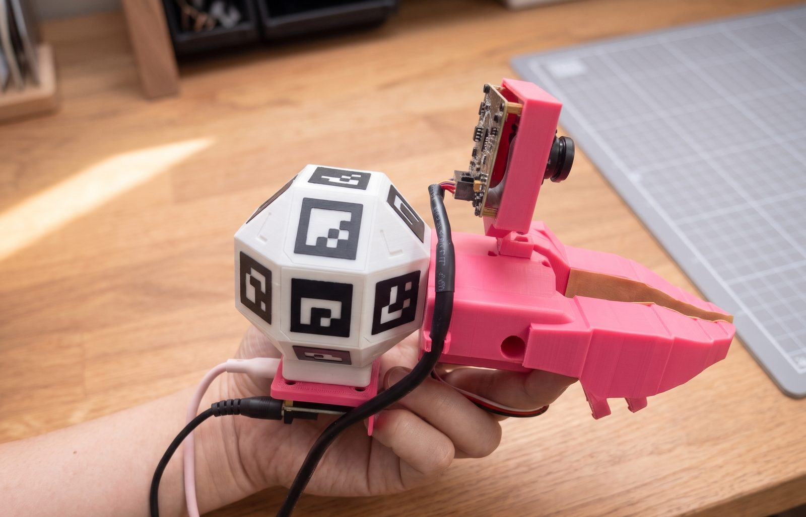
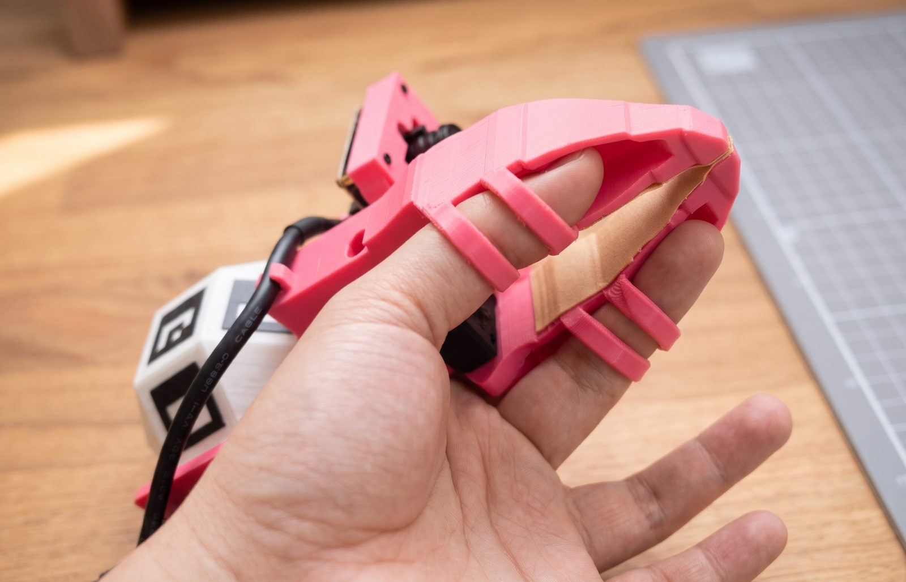

import JointRange from '../../../../components/JointRange.astro';
import Reach from '../../../../components/Reach.astro';

Pinkrab (Pink+Crab) is a bimanual robot fixed to an [IKEA SKÅDIS pegboard](https://www.ikea.com/us/en/p/skadis-pegboard-black-50534378/) on a wall. Each arm has **6 degrees of freedom**, not counting the gripper. It adds a wrist yaw joint to the 5-DoF arm [SO-ARM 101](https://github.com/TheRobotStudio/SO-ARM100) and uses a newly designed base so the arm can be mounted on a wall.

**Hermit**, which goes with it, is a UMI gripper built so the arm's claw can be held in the hand. When you move Hermit, the arms follow the same motion (teleoperation), and **the demonstration data for imitation learning is also collected with Hermit**.

Pinkrab's parts are printed in hot pink filament. The Pink in the name comes from this color, and the Crab from the way the body stays fixed to the wall while only the pincers move to do the work.

## Pinkrab

The added wrist yaw joint sits between wrist flex and wrist roll, and the bracket that supports it is also a printed part. Each arm holds seven Feetech STS3215 servos, which drive **six joints and the gripper**. Six joints let you specify both the position and the orientation of the tool, so all arm motion is computed with URDF-based inverse kinematics.

The arm is fixed to the board with an L-shaped base. The base holds the arm upright, so even when it hangs on a wall the shoulder pan axis is **vertical, just like an arm lying on a desk**.

A global shutter fisheye camera (ELP AR0234) on the wrist captures the claw and the work area in front of it in **a single view**.

### Specifications

| Item | Value |
|---|---|
| Degrees of freedom | 6 joints + gripper per arm |
| Servos | Feetech STS3215 (12 V), 7 per arm |
| Reach | Up to about 570 mm from the board surface to the tool tip (440 mm from the shoulder lift axis) |
| Payload | About 0.45 kg (calculated for the arm fully extended horizontally, from the shoulder lift servo's 30 kg·cm stall torque) |
| Arm weight | About 0.7 kg (including the base, URDF value) |
| Gripper | Jaw opens up to 80° |
| Pose accuracy | Joint error up to 0.8°, RMS around 0.2°, tool tip mean 1 mm (measured) |
| Max joint speed | 300°/s (limited by the safety gate) |
| Wrist camera | ELP AR0234, global shutter fisheye, 1920×1200 |
| Mounting | Default spacing between the two arms 480 mm, base top surface 180 mm above the desk (change it in [mounting dimensions](../../use/setup/#mount-dimensions)) |
| Power and communication | One 12 V 6 A adapter drives both arms; each arm connects over USB through one Seeed XIAO bus servo board |

### Reach

The painted area on the desk is where the tool can reach in grasping poses. With the tool tip 25 mm above the desk, a 2 cm cell is painted if an inverse kinematics solution exists for at least one of these directions: pointing down at 30°, 45°, or 60°, and 0° or ±45° left or right from the front of the board. It is the same calculation as the reach display in studio.

<Reach />

### Joint range

Choose a joint and the left arm moves it from one limit to the other. The right arm's range is **mirror-symmetric** to the left arm's.

<JointRange />

## Hermit

Hermit is a gripper made by attaching a handle to the arm's claw. The shapes of the claw and jaw, and the camera and where it is mounted, are the same as on the arm. The one servo inside does not drive the jaw and is used **only to read how far the jaw is open**.

During a demonstration, a top camera (global shutter AR0234, 120° lens) worn on the demonstrator's head films the UMI marker on the Hermit handle together with the table marker fixed to the desk. The pose of the UMI marker is computed relative to the table marker, so the tool pose is obtained **in desk coordinates** for every frame.

You hold Hermit with the thumb in the claw's two rings and the index finger in the jaw's two rings. Curling the index finger closes the jaw and extending it opens the jaw; on the arm, a servo opens and closes the jaw the same way.

Hermit and the arm have the same camera and claw, so a policy trained on video filmed with Hermit receives video that looks the same as in training when it runs on the arm. That is why collecting demonstrations **does not require Pinkrab**.

## Software components

| Component | Role |
|---|---|
| `pinkrab` CLI | Naming servo boards, checking servos, arm calibration, camera lens fit |
| `pinkrab-studio` | Browser workspace. Pinkrab rendered with MuJoCo, teleoperation, demonstration collection, training, policy execution |
| `pinkrab-umi` | Hermit-side programs. Camera recording, marker tracking, converting episodes to LeRobot datasets |
| ROS 2 nodes | The servo driver, the safety gate that checks the joint range, scene collisions, and speed of every command, and the bridge connecting studio to ROS |
| LeRobot plugin | Registers both arms as a single LeRobot robot type, `bi_pinkrab_follower` |

[LeRobot](https://github.com/huggingface/lerobot) is used for policy training. The policy is LeRobot's ACT ([Training](../../use/train/#policy)).

## Built on

Pinkrab is based on the ideas, designs, and code of the following projects.

- [Qubit](https://github.com/0xaiwhisperer/qubit), The A.I. Whisperer ([video](https://www.youtube.com/watch?v=MQBUOHRvMuc)): the idea of attaching an SO-ARM 101 to a wall above a desk
- [SO-ARM 100 / 101](https://github.com/TheRobotStudio/SO-ARM100), TheRobotStudio: the arm's basic structure, URDF, and most parts (Apache-2.0)
- [SO-ARM100 additional wrist joint](https://makerworld.com/en/models/2845098), ahb: the wrist yaw bracket (CC BY-SA)
- [UMI, the Universal Manipulation Interface](https://umi-gripper.github.io), Chi et al.: a way to collect demonstrations with a handheld gripper shaped like the robot gripper. Hermit implements this method for Pinkrab.
- [LeRobot](https://github.com/huggingface/lerobot), Hugging Face: dataset format, training code, policies
