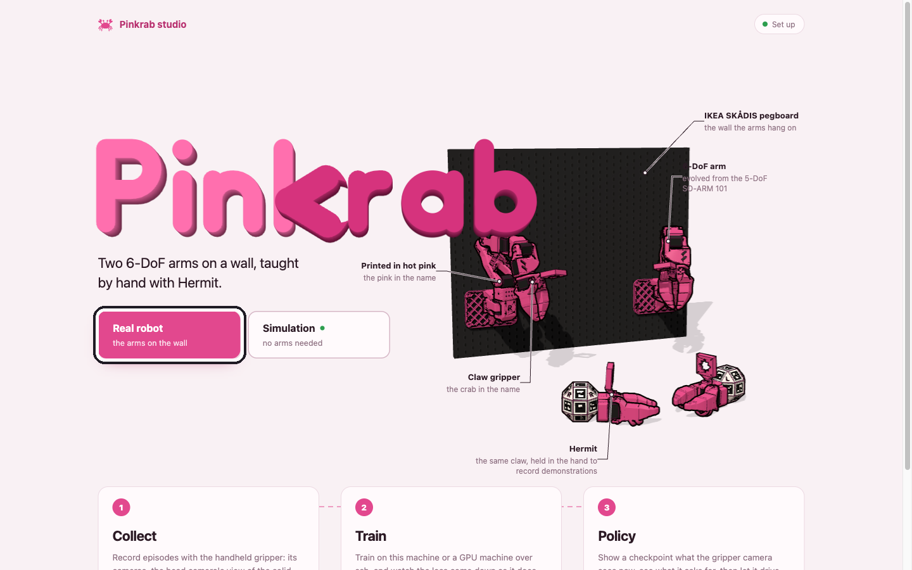
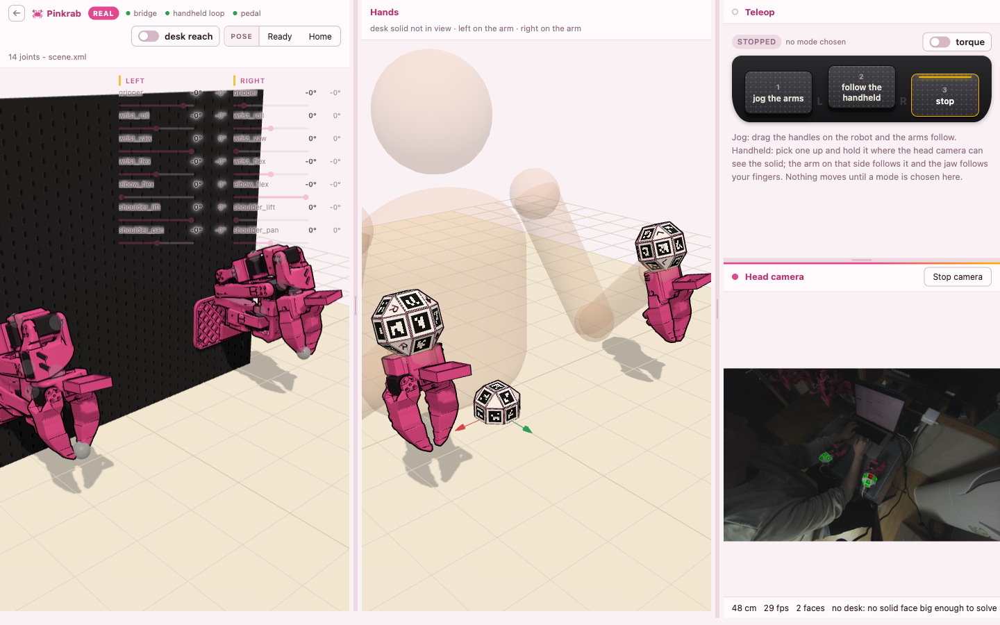
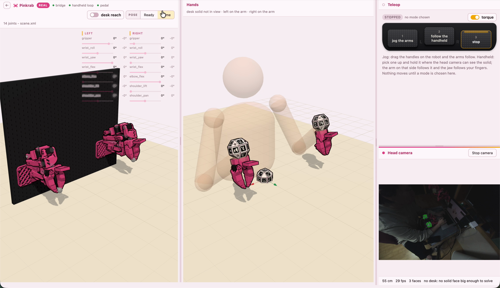

import Output from '../../../../components/Output.astro';
import Clip from '../../../../components/Clip.astro';
import studio from '../../../../transcripts/studio.txt?raw';
import bringup from '../../../../transcripts/bringup.txt?raw';

Move the set-up Pinkrab for the first time with teleoperation. When you move the Hermit in your hand, the arm on the same side follows that motion, and when you open and close the jaw with your index finger, the arm's gripper opens and closes with it. Before recording demonstrations, use this step to check that both arms follow Hermit properly and reach the place where the work will be done.

## Robot bringup

Pinkrab's servos **move only through ROS**. Run bringup on the computer the robot is connected to.

```bash
ros2 launch pinkrab_bringup robot.launch.py
```

<Output out={bringup} />

This launch starts the driver that opens the servo bus and the safety gate. Commands to the arms **all go through the safety gate**, which checks the joint range, collisions with the desk and board, and the joint speed (300° per second or less), and sends only the commands that pass to the driver. The driver is the only process that opens the servo bus, so there is no path to the servos that skips the gate.

## Running Pinkrab Studio

```bash
pinkrab-studio
```

<Output out={studio} />

Open http://localhost:8730/ in a browser and press **Real robot** on the home screen to open the Teleop page. If bringup is not up, "The robot is not up" appears with the launch command to run, so run the command above and press **Check again**.



In real robot mode, studio starts the bridge that connects it to ROS and the teleop node that follows Hermit, and the 3D arms on the screen show the real arms' servo positions as they are. Turn on the top camera and marker tracking too, with **Start camera** in the Top camera window of the Teleop page.



## Foot pedals

On the Teleop page, the three foot pedals work as follows, and you can also choose them with the same buttons on the screen. **The arms do not move** until you choose a mode.

| Pedal | Action on the Teleop page |
|---|---|
| 1 | jog: dragging the handle on the 3D arm on the screen makes the arm move after it |
| 2 | Moves following Hermit |
| 3 | Stop |

Pedal 3 **stops the arms in place on any page**. Turning the torque switch off **releases the arms' strength** so you can move them by hand, and turning it on makes them hold in place.



The **Ready** and **Home** buttons slowly take both arms to that pose. Ready is the pose to start operating with Hermit, and Home is used to lower the arms into the folded pose held during calibration in [Setup](../setup/#arm-calibration).

<Clip src="https://woolimi.cdn.prismic.io/woolimi/BEidRYKUnEH4p7U9_pinkrab-studio-ready.mp4" label="The Teleop screen where, after pressing Ready, both arms unfold from the folded Home pose to the Ready pose" caption="Ready button" />

<Clip src="https://woolimi.cdn.prismic.io/woolimi/CCX2YxHnmcBTw6q2_pinkrab-studio-home.mp4" label="The Teleop screen where, after pressing Home, both arms fold into the Home pose" caption="Home button" />

## Following Hermit

1. Send both arms to the Ready pose.
2. Mount the top camera on your head, place the table marker on the desk, hold a Hermit in each hand, and make sure **the UMI marker on the handle and the table marker are visible together to the top camera**.
3. Press **pedal 2** and move Hermit **slowly**.

<Clip src="https://woolimi.cdn.prismic.io/woolimi/FQn-8gDiRjTsYcpp_pinkrab-studio-teleop.mp4" label="Top is the real pair of arms, bottom is the Teleop screen at the same moment. After choosing follow the handheld and moving the Hermit in each hand, the real arms and the arms on the screen move together, and they stop when stop is pressed" caption="Following Hermit — real arms (top) and Teleop screen (bottom)" />

The arm follows not the place where Hermit is but **how far Hermit has moved**. The place where the arm was when you pressed pedal 2 and the place where Hermit first appeared become the reference, and after that, when Hermit goes 5 cm forward, the arm's tool also goes 5 cm forward. Hermit's motion is measured relative to the table marker, so the arm does not move when you turn your head. The table marker may be placed anywhere on the desk, but **if it disappears from the view, the arm stops**.

Which arm follows is decided by the UMI marker visible to the top camera, so **the left-hand Hermit moves the left arm and the right-hand Hermit moves the right arm**. If Hermit **disappears from the top camera for more than 0.5 seconds, that arm stops**, and when it becomes visible again that place becomes the new reference. To send an arm somewhere your hand cannot reach, cover Hermit briefly and make it visible again at a comfortable place.

If an arm moves strangely, **press pedal 3 right away**.
