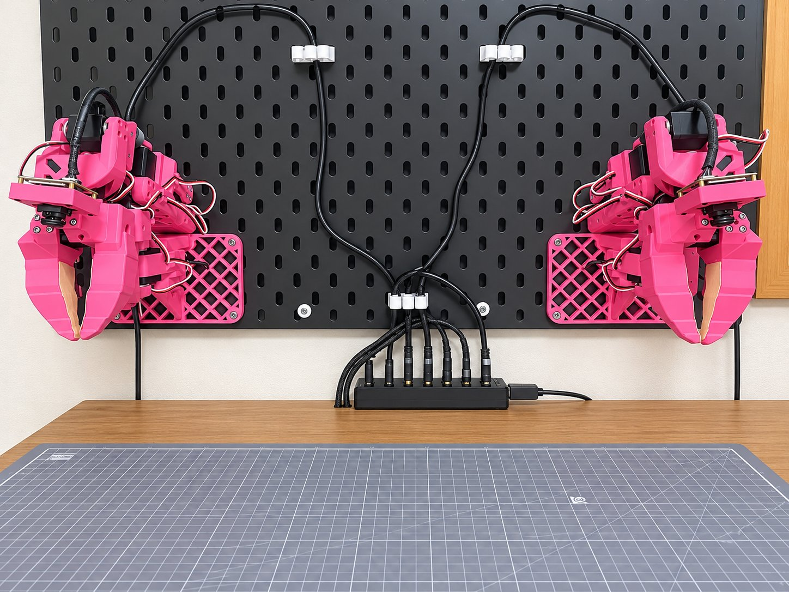
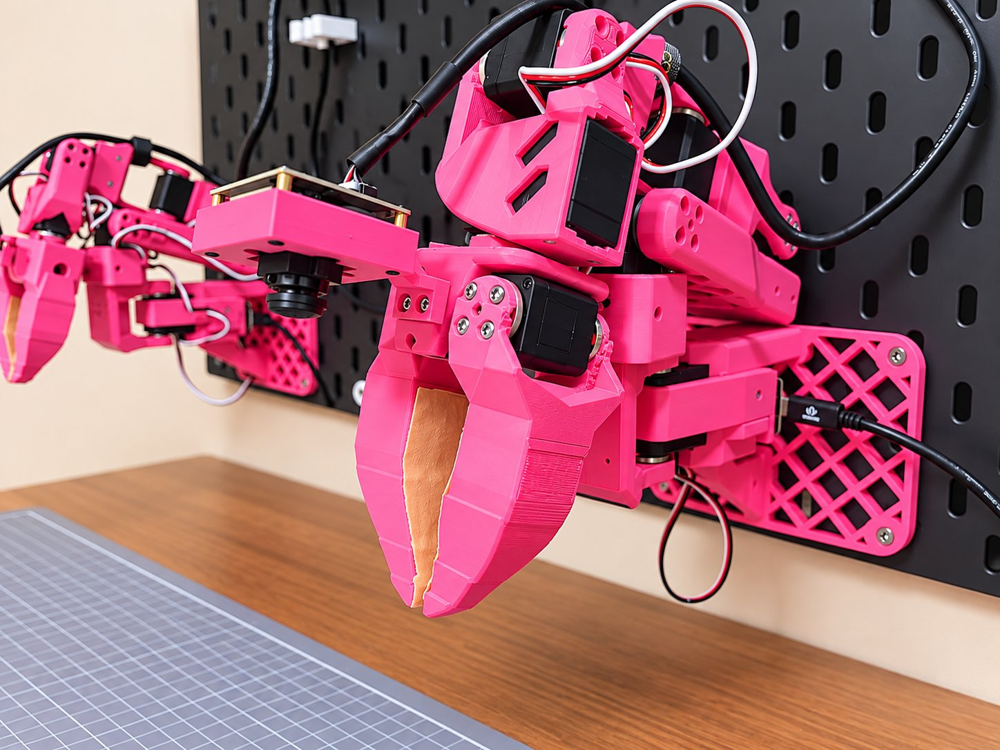
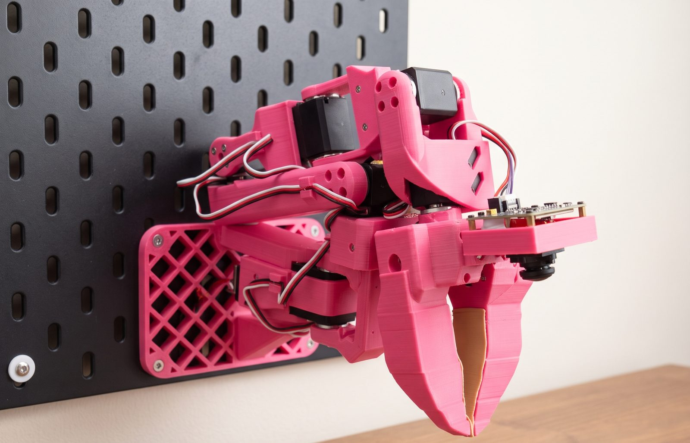
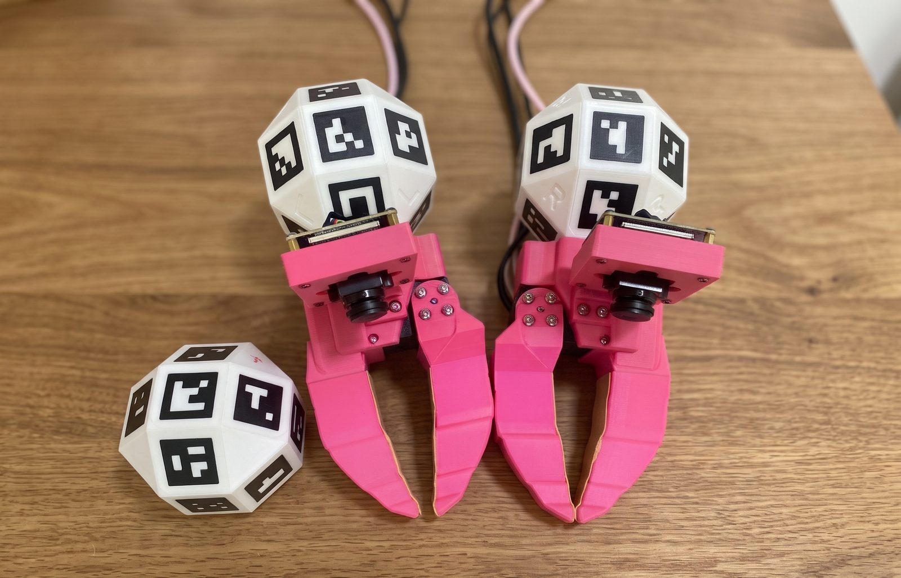
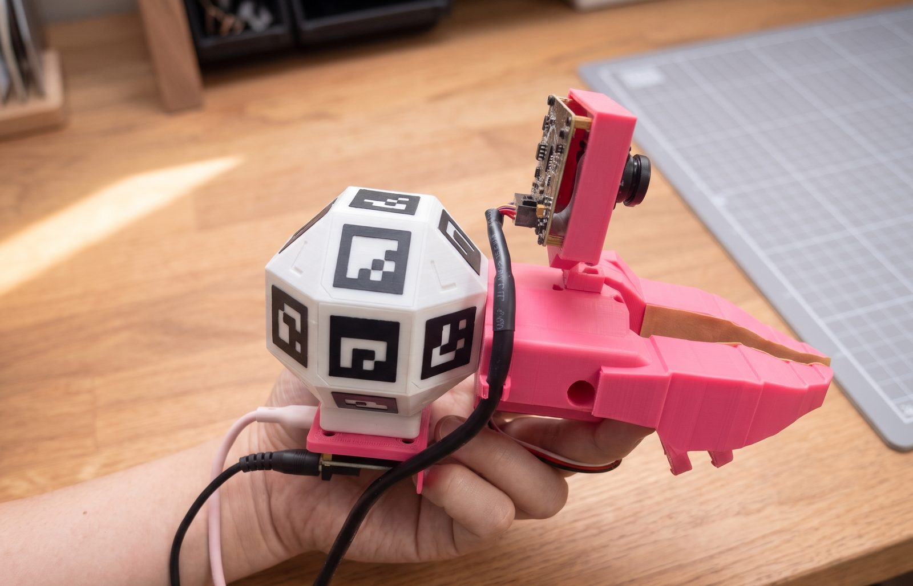
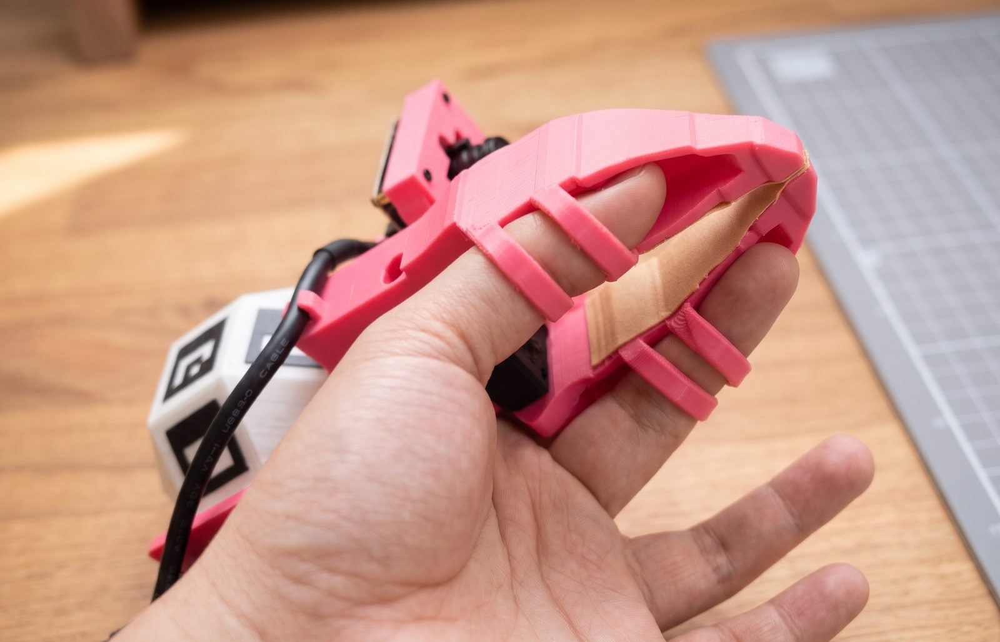

import JointRange from '../../../components/JointRange.astro';
import Reach from '../../../components/Reach.astro';

Pinkrab (Pink+Crab) 은 벽의 [IKEA SKÅDIS 페그보드](https://www.ikea.com/kr/ko/p/skadis-pegboard-black-30534379/)에 고정하는 양팔 로봇이며, 팔마다 gripper 를 제외하고 **6자유도**입니다. 5자유도 팔인 [SO-ARM 101](https://github.com/TheRobotStudio/SO-ARM100) 에 wrist yaw 관절을 추가하고, 벽에 부착할 수 있도록 베이스를 새로 설계했습니다.

함께 쓰는 **Hermit** 은 팔의 claw 를 손에 들 수 있게 만든 UMI 그리퍼입니다. Hermit 을 들고 움직이면 팔이 같은 움직임을 따라 하는 teleoperation 이 되고, imitation learning 에 쓸 **시연 데이터도 Hermit 으로 수집**합니다.

Pinkrab 의 부품은 핫핑크 필라멘트로 출력합니다. 이름의 Pink 는 이 색에서, Crab 은 몸체를 벽에 고정한 채 집게만 움직여 작업하는 모습에서 따왔습니다.

## Pinkrab

추가한 wrist yaw 관절은 wrist flex 와 wrist roll 사이에 있고, 이 관절을 받치는 브래킷도 출력 부품입니다. 팔마다 **관절 여섯 개와 gripper** 를 구동하는 Feetech STS3215 서보가 일곱 개 들어갑니다. 관절이 여섯 개라 tool 의 위치와 방향을 모두 지정할 수 있으므로, 팔의 동작은 전부 URDF 기반 inverse kinematics 로 계산합니다.

팔은 L 자 베이스로 보드에 고정합니다. 베이스가 팔을 세워 받치므로, 벽에 걸린 상태에서도 shoulder pan 축은 책상 위에 놓은 팔과 **같이 수직**입니다.

손목에는 global shutter 어안 카메라(ELP AR0234)가 달려 있어 claw 와 그 앞의 작업 영역이 **한 화면**에 들어옵니다.

### 사양

| 항목 | 값 |
|---|---|
| 자유도 | 팔마다 관절 6개 + gripper |
| 서보 | Feetech STS3215 (12 V), 팔마다 7개 |
| 도달 거리 | 보드 면에서 tool 끝까지 최대 약 570 mm (shoulder lift 축 기준 440 mm) |
| 가반 하중 | 약 0.45 kg (팔을 수평으로 끝까지 뻗은 자세, shoulder lift 서보 정지 토크 30 kg·cm 기준 계산값) |
| 팔 무게 | 약 0.7 kg (베이스 포함, URDF 값) |
| 그리퍼 | jaw 최대 80° 열림 |
| 자세 정확도 | 관절 오차 최대 0.8°, RMS 0.2° 안팎, tool 끝 평균 1 mm (실측) |
| 최대 관절 속도 | 300°/s (safety gate 제한) |
| 손목 카메라 | ELP AR0234, global shutter 어안, 1920×1200 |
| 설치 | 기본 두 팔 간격 480 mm, 베이스 윗면 높이 책상 위 180 mm ([설치 치수](../../use/setup/#설치-치수)에서 변경) |
| 전원·통신 | 12 V 6 A 어댑터 하나로 양팔 구동, 팔마다 Seeed XIAO bus servo 보드 하나로 USB 연결 |

### 도달 거리

책상에 칠한 영역은 물건을 집는 자세로 tool 이 닿는 자리입니다. tool 끝을 책상 위 25 mm 높이에 두고 아래로 30°·45°·60°, 보드 정면에서 좌우 0°·±45° 가운데 한 방향으로라도 inverse kinematics 해가 있으면 그 2 cm 칸을 칠했습니다. studio 의 reach 표시와 같은 계산입니다.

<Reach />

### 관절 가동 범위

관절을 고르면 왼팔이 그 관절을 한쪽 한계에서 반대쪽 한계까지 움직입니다. 오른팔의 범위는 왼팔과 **좌우 대칭**입니다.

<JointRange />

## Hermit

Hermit 은 팔의 claw 에 손잡이를 붙인 형태의 그리퍼로, claw 와 jaw 의 형상, 카메라와 그 장착 위치가 팔과 같습니다. 안에 든 서보 하나는 jaw 를 구동하지 않고 **jaw 가 열린 정도를 읽는 데만** 씁니다.

시연 중에는 시연자 머리에 단 탑 카메라(global shutter AR0234, 120° 렌즈)가 Hermit 손잡이의 UMI 마커와 책상에 고정한 테이블 마커를 함께 촬영합니다. UMI 마커의 pose 를 테이블 마커 기준으로 계산하므로, 매 프레임 tool 의 pose 를 **책상 좌표계로** 얻습니다.

Hermit 은 엄지를 claw 의 고리 두 개에, 검지를 jaw 의 고리 두 개에 끼워 쥡니다. 검지를 오므리면 jaw 가 닫히고 펴면 열리며, 팔에서는 서보가 같은 방식으로 jaw 를 여닫습니다.

Hermit 과 팔은 카메라와 claw 가 같아서, Hermit 으로 촬영한 영상으로 학습한 policy 는 팔에서 실행할 때도 학습 때와 같은 모습의 영상을 입력으로 받습니다. 그래서 시연을 수집할 때는 **Pinkrab 이 없어도 됩니다**.

## 소프트웨어 구성

| 구성 요소 | 역할 |
|---|---|
| `pinkrab` CLI | 서보 보드 이름 지정, 서보 점검, 팔 calibration, 카메라 렌즈 fit |
| `pinkrab-studio` | 브라우저 작업 화면. MuJoCo 로 그린 Pinkrab, teleoperation, 시연 수집, 학습, policy 실행 |
| `pinkrab-umi` | Hermit 쪽 프로그램. 카메라 녹화, 마커 추적, episode 의 LeRobot dataset 변환 |
| ROS 2 노드 | 서보 driver, 모든 명령의 joint 범위·장면 충돌·속도를 검사하는 safety gate, studio 와 ROS 를 잇는 bridge |
| LeRobot plugin | 두 팔을 LeRobot 의 robot type `bi_pinkrab_follower` 하나로 등록 |

Policy 학습에는 [LeRobot](https://github.com/huggingface/lerobot) 을 사용합니다. policy 는 LeRobot 의 ACT 입니다([학습](../../use/train/#policy)).

## 기반 프로젝트

Pinkrab 은 다음 프로젝트의 아이디어와 설계, 코드를 바탕으로 합니다.

- [Qubit](https://github.com/0xaiwhisperer/qubit), The A.I. Whisperer([영상](https://www.youtube.com/watch?v=MQBUOHRvMuc)): 책상 위 벽에 SO-ARM 101 을 부착하는 아이디어
- [SO-ARM 100 / 101](https://github.com/TheRobotStudio/SO-ARM100), TheRobotStudio: 팔의 기본 구조, URDF, 부품 대부분 (Apache-2.0)
- [SO-ARM100 additional wrist joint](https://makerworld.com/en/models/2845098), ahb: wrist yaw 브래킷 (CC BY-SA)
- [UMI, the Universal Manipulation Interface](https://umi-gripper.github.io), Chi et al.: 로봇 gripper 와 같은 모양의 handheld gripper 로 시연을 수집하는 방법. Hermit 은 이 방법을 Pinkrab 에 맞게 구현했습니다.
- [LeRobot](https://github.com/huggingface/lerobot), Hugging Face: dataset 형식, 학습 코드, policy
