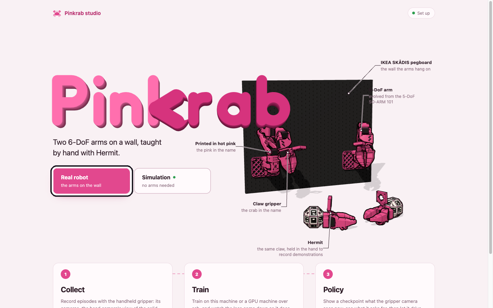
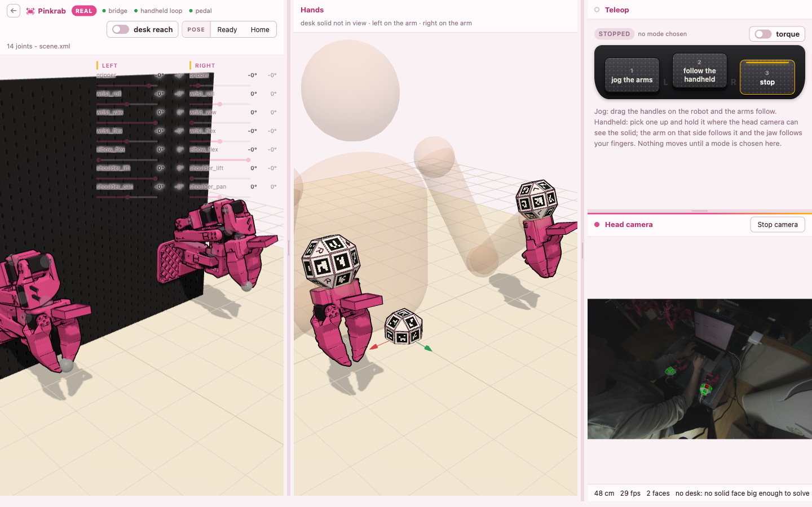
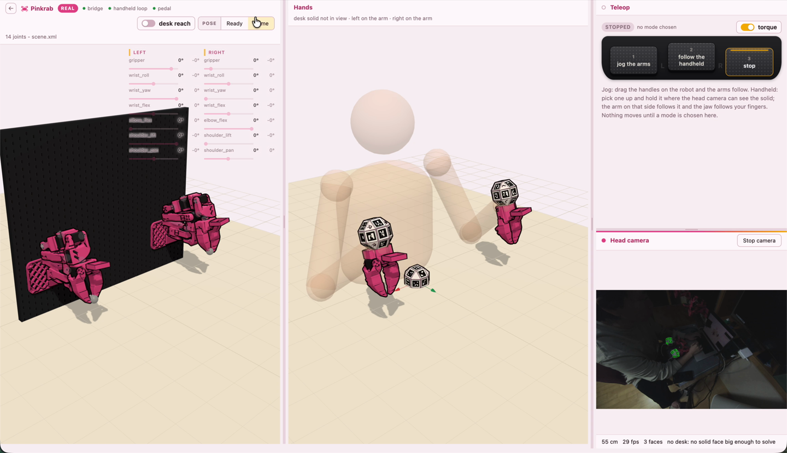

import Output from '../../../components/Output.astro';
import Clip from '../../../components/Clip.astro';
import studio from '../../../transcripts/studio.txt?raw';
import bringup from '../../../transcripts/bringup.txt?raw';

준비를 마친 Pinkrab 은 teleoperation 으로 처음 움직여 봅니다. 손에 든 Hermit 을 움직이면 같은 쪽 팔이 그 움직임을 따라 하고, 검지로 jaw 를 여닫으면 팔의 gripper 도 같이 여닫힙니다. 시연을 녹화하기 전에 이 단계에서 두 팔이 Hermit 을 제대로 따라오는지, 작업할 자리까지 닿는지 확인합니다.

## 로봇 bringup

Pinkrab 의 서보는 **ROS 로만 움직입니다**. 로봇이 연결된 컴퓨터에서 bringup 을 실행합니다.

```bash
ros2 launch pinkrab_bringup robot.launch.py
```

<Output out={bringup} />

이 launch 가 서보 버스를 여는 driver 와 safety gate 를 띄웁니다. 팔에 가는 명령은 **모두 safety gate 를 거치며**, gate 는 관절 범위와 책상·보드와의 충돌, 관절 속도(초당 300° 이하)를 검사해 통과한 명령만 driver 로 보냅니다. 서보 버스를 여는 프로세스는 driver 하나뿐이라 gate 를 거치지 않고 서보에 닿는 길은 없습니다.

## Pinkrab Studio 실행

```bash
pinkrab-studio
```

<Output out={studio} />

브라우저에서 http://localhost:8730/ 을 열고 첫 화면에서 **Real robot** 을 누르면 Teleop 페이지가 열립니다. bringup 이 떠 있지 않으면 "The robot is not up" 이 뜨면서 실행할 launch 명령을 보여 주니, 위 명령을 실행한 뒤 **Check again** 을 누릅니다.



실물 모드에서는 studio 가 ROS 와 이어 주는 bridge 와 Hermit 을 따라가는 teleop 노드를 함께 띄우고, 화면의 3D 팔은 실제 팔의 서보 위치를 그대로 보여 줍니다. Teleop 페이지의 Top camera 창에서 **Start camera** 를 눌러 탑 카메라와 마커 추적도 켭니다.



## 풋 페달

Teleop 페이지에서 풋 페달 세 개는 다음과 같이 동작하고, 화면의 같은 버튼으로도 고를 수 있습니다. 모드를 고르기 전에는 **팔이 움직이지 않습니다**.

| 페달 | Teleop 페이지에서의 동작 |
|---|---|
| 1 | jog: 화면의 3D 팔에 있는 손잡이를 끌면 팔이 따라 움직입니다 |
| 2 | Hermit 을 따라 움직입니다 |
| 3 | 정지 |

페달 3 은 **어느 페이지에서든 팔을 그 자리에 세웁니다**. 토크 스위치를 끄면 **팔에 힘이 빠져** 손으로 움직일 수 있게 되고, 켜면 그 자리에서 버팁니다.



**Ready** 와 **Home** 버튼은 두 팔을 그 자세까지 천천히 데려갑니다. Ready 는 Hermit 으로 조작을 시작하는 자세이고, Home 은 [준비](../setup/#팔-calibration)의 calibration 에서 잡았던 접힌 자세로 팔을 내려놓을 때 씁니다.

<Clip src="https://woolimi.cdn.prismic.io/woolimi/BEidRYKUnEH4p7U9_pinkrab-studio-ready.mp4" label="Ready 를 누르자 두 팔이 접힌 Home 자세에서 Ready 자세로 펴지는 Teleop 화면" caption="Ready 버튼" />

<Clip src="https://woolimi.cdn.prismic.io/woolimi/CCX2YxHnmcBTw6q2_pinkrab-studio-home.mp4" label="Home 을 누르자 두 팔이 Home 자세로 접히는 Teleop 화면" caption="Home 버튼" />

## Hermit 따라가기

1. 두 팔을 Ready 자세로 보냅니다.
2. 탑 카메라를 머리에 달고 책상에 테이블 마커를 놓은 뒤, 양손에 Hermit 을 들고 손잡이의 **UMI 마커와 테이블 마커가 함께 탑 카메라에 보이게** 합니다.
3. **페달 2** 를 밟고 Hermit 을 **천천히** 움직입니다.

<Clip src="https://woolimi.cdn.prismic.io/woolimi/FQn-8gDiRjTsYcpp_pinkrab-studio-teleop.mp4" label="위는 실제 두 팔, 아래는 같은 순간의 Teleop 화면. follow the handheld 를 고른 뒤 양손의 Hermit 을 움직이자 실제 팔과 화면 속 팔이 함께 따라 움직이고, stop 을 누르자 멈춥니다" caption="Hermit 따라가기 — 실제 팔(위)과 Teleop 화면(아래)" />

팔은 Hermit 이 있는 자리가 아니라 **Hermit 이 움직인 만큼**을 따라갑니다. 페달 2 를 밟은 순간 팔이 있던 자리와 Hermit 이 처음 보인 자리가 기준이 되고, 그 뒤로 Hermit 이 앞으로 5 cm 가면 팔의 tool 도 앞으로 5 cm 갑니다. Hermit 의 움직임은 테이블 마커를 기준으로 재므로 고개를 돌려도 팔은 움직이지 않습니다. 테이블 마커는 책상 어디에 두어도 되지만, **화면에서 사라지면 팔이 멈춥니다**.

어느 팔이 따라갈지는 탑 카메라에 보이는 UMI 마커가 정하므로, **왼손 Hermit 은 왼팔을, 오른손 Hermit 은 오른팔을** 움직입니다. Hermit 이 **0.5 초 넘게 탑 카메라에서 사라지면 그 팔은 멈추고**, 다시 보이면 그 자리가 새 기준이 됩니다. 손이 닿지 않는 곳까지 팔을 보내고 싶을 때는 Hermit 을 잠깐 가렸다가 편한 자리에서 다시 보이게 하면 됩니다.

팔이 이상하게 움직이면 **바로 페달 3** 을 밟습니다.
